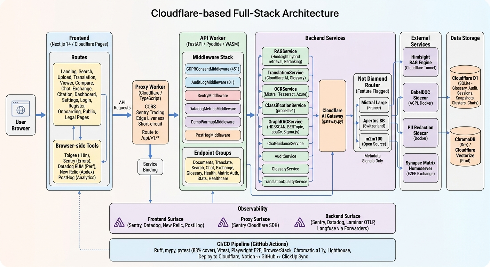
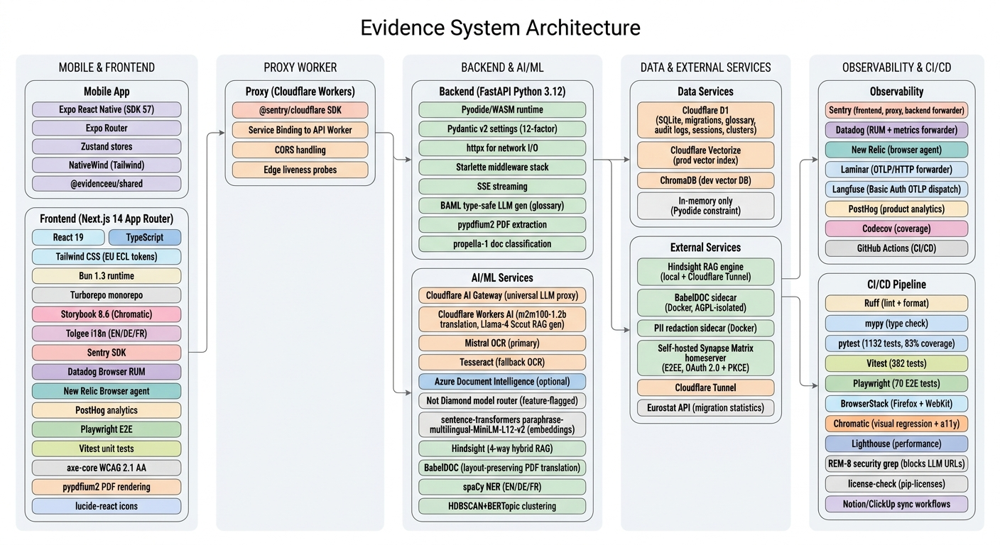

# EvidenceEU 🇪🇺

<p align="center">
  
</p>
<p align="center"><b>[ Generated with <a href="https://docs.sylph.ai/features/image-generation">AdaL</a> ]</b></p>

**CI/CD & Quality**

[](https://github.com/chindris-mihai-alexandru/evidence-eu/actions/workflows/ci.yml)
[](https://codecov.io/github/chindris-mihai-alexandru/evidence-eu) <!-- coverage: 99% (combined line+branch, floored; matrix_auth 99%, rag_service 97%, documents improved) -->
[](https://pages.cloudflare.com)
[](LICENSE)
[](frontend/LICENSE)

**Backend**

[](https://www.python.org)
[](https://fastapi.tiangolo.com)

**Frontend**

[](https://nextjs.org)
[](https://bun.sh)
[](https://turbo.build)
[](https://www.chromatic.com/builds?appId=6a2c85ba9b73c9f8f94a64e0)

**Mobile**

[](https://expo.dev/projects/5d43a3c5-eb32-417b-9337-7e328653d1d6)

**Testing**

[](https://playwright.dev)
[](https://www.browserstack.com/projects/3939524)
[](https://locust.io)
[](https://k6.io)

**AI & Infrastructure**

[](https://dash.cloudflare.com/9f26393d5ba4186296b36e2af8714b1c/workers-and-pages)
[](https://boundaryml.com)
[](https://developers.cloudflare.com/cloudflare-one/connections/connect-apps/)
[](https://portal.azure.com/#@ellakarenmarianohotmail.onmicrosoft.com/resource/subscriptions/3c51aa75-e0e0-42cb-a388-f8b4b1cc21b3/resourceGroups/rg-evidenceeu-capstone/providers/Microsoft.CognitiveServices/accounts/evidenceeu-docintel-km-2026/overview)

**Observability**

[](https://quantic-school-of-business-and.sentry.io/projects/evidence-eu-frontend/?project=4511587236577360)
[](https://app.us5.datadoghq.com/rum/summary?query=%40application.id%3Acea8635f-6c64-479b-a831-26db5d819ba6)
[](https://one.eu.newrelic.com/dashboards?account=8188968&state=b9679937-03c8-8991-17be-dc77a8f1d462)
[](https://laminar.sh/project/037cc1e3-1337-44a2-baea-8baf8361ea4b/dashboards)
[](https://cloud.langfuse.com/project/cmrctoxw40ci7ad0dag18cm4g)
[](https://eu.posthog.com/project/227110)

**Localization**

[](https://app.tolgee.io/projects/33096)

**Project**

[](https://interesting-crawdad-5e0.notion.site/EvidenceEU-38cbf1cf330680aabda5e32554524599)
[](https://github.com/chindris-mihai-alexandru/evidence-eu/issues?q=is%3Aissue)
[](https://chindris-mihai-alexandru.github.io/evidence-eu/)

**Multilingual Document Intelligence for Cross-Border Europe**

*The multilingual document platform for cross-border Europe, built for migrants, legal professionals, and HR teams who need to search, understand, and translate official documents across EN, DE and FR, without losing a single table or signature.*

**Phase 1 (current scope, per capstone deliverables):** cross-border document intelligence for migrants, legal, and HR — RAG search, layout-preserving translation, and E2EE document exchange on Cloudflare's EU edge with GDPR built in.

**Phase 2 (planned post-submission extension):** extend the same multilingual engine into healthcare as an EU-native clinical decision-support layer aligned with the European Health Data Space (EHDS) for secure cross-border medical document exchange (TI-Messenger-compatible), with a `medical` terminology domain the architecture already supports. Design and routing are built to grow into medtech without a rebrand.

### Capstone Submission Deliverables

Per the Quantic MSSE Capstone Handbook:

1. **Agile task board** — [Notion Scrum Board](https://interesting-crawdad-5e0.notion.site/38cbf1cf330681b484d0c68d7fc9505c?v=38cbf1cf330680d3b7db000c67ca4e8d) — 58 tasks (46 across 3 sprints + 13 in product backlog) with full descriptions, assignees, and implementation evidence.

   **13 User Stories** (product backlog, all complete):

   | ID | User Story |
   |----|-----------|
   | US-01 | Upload a document for translation |
   | US-02 | Extract text from scanned PDFs |
   | US-03 | Translate document to target language |
   | US-04 | View original and translation side by side |
   | US-05 | Consistent legal terminology in translations |
   | US-06 | Search EU public documents in my language |
   | US-07 | GDPR-compliant data handling |
   | US-08 | Compare two documents with diff highlighting |
   | US-09 | Securely share documents between institutions |
   | US-10 | Log in with institution Matrix identity |
   | US-11 | Protection against AI prompt injection |
   | US-12 | Fast page load under real conditions |
   | US-13 | Conversational RAG with source citations |

   Full definitions with acceptance criteria and FR mapping: [use-case.md §5.5](use-case.md)

   *Note: We migrated from ClickUp to Notion because ClickUp requires account creation to view boards, whereas Notion allows public access without signing up.*
2. **Design & testing document** — [docs/design-and-testing.md](docs/design-and-testing.md) (architecture decisions, patterns, and testing strategy)
3. **Recorded demonstration** — [Final capstone demo](https://drive.google.com/file/d/14IbGfTzgsW9lHhzlC3CxWqYK0y7_17O9/view?usp=sharing) — 15–20 min capstone demo, all members present on camera with ID

---

## Problem Statement

Europe has over 43 million non-EU citizens ([Eurostat, 2024](https://ec.europa.eu/eurostat/databrowser/view/migr_pop1ctz/default/table?lang=en)) — migrants, cross-border workers, and legal professionals who regularly handle foreign-language bureaucratic, legal, and administrative documents every day. Existing tools either translate text without preserving layout ([DeepL](https://www.deepl.com) breaks your tables), serve narrow verticals in English only ([Harvey](https://harvey.ai), [Legora](https://legora.com), [MikeOSS](https://mikeoss.com)), or require self-hosting enterprise infrastructure. No platform combines multilingual search, layout-preserving translation, and secure cross-border document exchange for the general cross-border document user, fully hosted on Cloudflare's EU edge with GDPR compliance built in.

---

## Solution

EvidenceEU delivers three capabilities in one platform:

| Pillar | What It Does |
|--------|-------------|
| **Search & Intelligence** | RAG-powered search across EU public documents in any EU language — query in German, get answers from French regulations, with source citations |
| **Translation & Formatting** | Upload a PDF bureaucratic or legal document and receive a translated version with tables, columns, signatures, and layout fully preserved — text blocks translated via m2m100-1.2b (Cloudflare Workers AI, EN/DE/FR), layout composition via BabelDOC sidecar |
| **Cross-Border Exchange** | Securely share and receive translated documents across borders via [Matrix protocol](https://matrix.org) (E2EE, federated, GDPR-native) |

---

## Architecture

<p align="center">
  
</p>

### AI Model Routing (Not Diamond)

Translation and RAG queries are routed through [Not Diamond](https://www.notdiamond.ai) — an intelligent model router that selects the best LLM per task based on complexity, cost, and latency signals. A custom router (trained on EvidenceEU's 30 translation test cases) routes between three European models:

| Model | Role | Avg Quality | Origin |
|-------|------|-------------|--------|
| Mistral Large | Frontier translation | 0.811 | France |
| Apertus 8B | Sovereign RAG + translation | 0.611 | Switzerland |
| m2m100-1.2b | Cheap text translation | 0.542 | Open-source |

**Status:** Feature-flagged (`NOT_DIAMOND_ENABLED=false` by default). When disabled, the router is a transparent no-op.

**GDPR guarantee:** only metadata signals (language pair, document type, complexity score) are sent to Not Diamond — never document content. See [ADR-015](docs/adr/ADR-015-translation-model-replacement-strategy.md) for the post-capstone model replacement strategy.

---

## Architecture Decision Records

*Records follow the [MADR](docs/adr/README.md) convention — one decision per ADR, with a documented status vocabulary and cross-references.*

| ADR | Decision |
|-----|---------|
| [ADR-001](docs/adr/ADR-001-rag-vector-db.md) | ChromaDB (dev) + Cloudflare Vectorize (prod) |
| [ADR-002](docs/adr/ADR-002-translation-babeldoc.md) | Translation engine — BabelDOC (layout-preserving, capstone) via Cloudflare Workers AI; m2m100-1.2b text-only fallback |
| [ADR-003](docs/adr/ADR-003-matrix-protocol.md) | Matrix protocol for secure cross-border exchange |
| [ADR-004](docs/adr/ADR-004-cloudflare-infrastructure.md) | Cloudflare-native edge infrastructure |
| [ADR-005](docs/adr/ADR-005-glossary-terminology.md) | Domain glossary for legal term consistency (EN/DE/FR) |
| [ADR-006](docs/adr/ADR-006-pdf-extraction-license.md) | PDF extraction library — license-driven choice (PyMuPDF → pypdfium2) |
| [ADR-007](docs/adr/ADR-007-memory-rag-layer.md) | Memory/RAG layer — single-vendor discipline (Hindsight; Letta/Cognee deferred) |
| [ADR-008](docs/adr/ADR-008-licensing-strategy.md) | Licensing strategy — AGPL open core with dual licensing |
| [ADR-009](docs/adr/ADR-009-reducto-vs-inhouse-ocr.md) | Reducto (public corpus only) vs in-house OCR (user uploads) — GDPR boundary |
| [ADR-010](docs/adr/ADR-010-baml-llm-interface.md) | BAML type-safe LLM generation (glossary only) + AdalFlow offline prompt optimization |
| [ADR-011](docs/adr/ADR-011-ui-testing.md) | UI testing strategy — Storybook 8.6 + Chromatic TurboSnap + Vitest boundary (Playwright deferred) |
| [ADR-012](docs/adr/ADR-012-babeldoc-sidecar-runtime.md) | BabelDOC sidecar runtime — AGPL isolation via HTTP boundary, Docker container |
| [ADR-013](docs/adr/ADR-013-release-tagging-strategy.md) | Release tagging strategy — pre-1.0 semver per sprint, SRS tags, GitHub Releases |
| [ADR-014](docs/adr/ADR-014-defer-adal-sdk-cloud-agents.md) | Defer AdaL SDK & Cloud Agents to post-capstone — in-house RAG + translation backend sufficient |
| [ADR-015](docs/adr/ADR-015-translation-model-replacement-strategy.md) | Translation model replacement — Apertus 8B (Apache 2.0, Swiss) replaces m2m100 post-capstone; EuroLLM-22B as Phase 2 |
| [ADR-016](docs/adr/ADR-016-hindsight-hosting-strategy.md) | Hindsight hosting strategy — local Docker + Cloudflare Tunnel (Cloud/BYOC fallback) |
| [ADR-017](docs/adr/ADR-017-capstone-mvp-operating-envelope.md) | Capstone MVP operating envelope — scope, sprint, and submission constraints |
| [ADR-018](docs/adr/ADR-018-matrix-authentication.md) | Matrix authentication — self-hosted Synapse homeserver (`evidenceeu.eu.mihai.codes`) with OAuth PKCE, no matrix.org dependency. Superseded by ADR-019. |
| [ADR-019](docs/adr/ADR-019-matrix-oauth-pkce-authentication.md) | Matrix OAuth PKCE — delegated OAuth flow with PKCE for secure token exchange |
| [ADR-020](docs/adr/ADR-020-ocr-strategy-and-form-parsing.md) | OCR strategy — three-path document routing (scanned → Mistral OCR, fillable → PyPDF2 form parsing, XFA → fallback); dots.ocr deferred post-capstone |
| [ADR-021](docs/adr/ADR-021-composed-fillable-pdf-translation.md) | Composed PDF reference translation — native-text & fillable PDF understanding, EU-law context (extends ADR-002/006/012) |
| [ADR-022](docs/adr/ADR-022-knowledgebase-integration.md) | KnowledgeBase integration — offline clustering (HDBSCAN+BERTopic), NER (spaCy EN/DE/FR), Sigma.js graph, graph-augmented RAG; all pipelines offline — no NFR-01 impact (extends ADR-007 Memory/RAG) |
| [ADR-023](docs/adr/ADR-023-linus-integration.md) | Linus integration evaluation — document-to-graph pipeline (PDF→Neo4j), graph-augmented retrieval strategy; extends ADR-022 KnowledgeBase |

---

## Tech Stack

<p align="center">
  
</p>

---

## Getting Started & Running the Project

### Prerequisites
- **[Docker](https://docker.com) & Docker Compose** (for containerized environment)
- **[Bun](https://bun.sh) 1.3.14+** (primary, for local frontend development & CI/CD): `curl -fsSL https://bun.sh/install | bash`
- **[Node.js](https://nodejs.org) v20+ & npm** (fallback — Cloudflare Pages production runtime is V8-based, not Bun)
- **[Python](https://python.org) 3.12+ & [uv](https://github.com/astral-sh/uv)** (for local backend development)
- **[make](https://www.gnu.org/software/make/)** utility

---

### Method A: Running with Docker (Recommended)

This starts the entire stack: Next.js Frontend (`:3000`), FastAPI Backend (`:8000`), [ChromaDB](https://www.trychroma.com) (`:8500`), [Hindsight](https://hindsight.vectorize.io) RAG service (`:8600` API / `:9999` control panel), [propella](https://github.com/sgl-project/sglang) document classifier (`:8700`), and optionally [BabelDOC](https://github.com/funstory-ai/BabelDOC) PDF translation sidecar (`:8750`, requires `--profile babeldoc`) and PII redaction sidecar (requires `--profile pii-redaction`).

```bash
# 1. Clone the repository
git clone https://github.com/chindris-mihai-alexandru/evidence-eu.git
cd evidence-eu

# 2. Configure environment variables
cp .env.example .env                      # Root .env — Docker Compose interpolation (Hindsight LLM key)
cp .env.example backend/.env              # Backend .env — FastAPI config
cp frontend/.env.local.example frontend/.env.local

# 3. Edit .env and set your Groq API key (required for Hindsight RAG)
#    Get a free key at https://console.groq.com/keys
sed -i.bak 's/^HINDSIGHT_LLM_API_KEY=.*/HINDSIGHT_LLM_API_KEY=your-groq-key-here/' .env && rm -f .env.bak

# 4. Install Python deps for the seed script (on host, not in Docker)
uv pip install hindsight-client

# 5. Spin up the containers (with file-system watch enabled)
make dev

# Optional: Start BabelDOC sidecar for layout-preserving PDF translation
# docker compose --profile babeldoc up babeldoc -d

# Optional: Start PII redaction sidecar for GDPR Art. 5 data minimisation
# docker compose --profile pii-redaction up pii-redactor -d

# 6. Seed the initial document corpus (runs RAG ingestion)
make seed
```

Once running:
- **Web App:** [http://localhost:3000](http://localhost:3000)
- **Backend API Docs (Swagger):** [http://localhost:8000/docs](http://localhost:8000/docs)
- **Hindsight Control Panel:** [http://localhost:9999](http://localhost:9999)
- **Propella Classifier:** [http://localhost:8700](http://localhost:8700)

---

### Method B: Running Locally (Without Docker)

For faster iteration and IDE debugging, you can run the components directly on your host machine.

#### 1. Backend Setup
Make sure you have [uv](https://github.com/astral-sh/uv) installed:
```bash
cd backend

# Install dependencies in a virtual environment
uv venv
source .venv/bin/activate
uv pip install -e .

# Start the FastAPI server (reloads on changes)
uvicorn app.main:app --reload --host 127.0.0.1 --port 8000
```

#### 2. Frontend Setup
```bash
cd frontend

# Install dependencies ([Bun](https://bun.sh) is ~7x faster than npm)
bun install

# Start Next.js development server
bun run dev

# Start Storybook (component explorer, port 6006)
bun run storybook
```

#### 3. Mobile App Setup
```bash
cd apps/mobile

# Install dependencies (from repo root for workspace resolution)
bun install

# Start Expo dev server (web mode)
npx expo start --web

# Start Expo dev server (iOS simulator — requires macOS + Xcode)
npx expo start --ios

# Start Expo dev server (Android emulator — requires Android Studio)
npx expo start --android
```

The mobile app uses **Expo Router** (file-based routing), **NativeWind** (Tailwind CSS), and **Zustand** (state management). Shared types and utilities live in `packages/shared/` and are imported by both web and mobile apps.

#### Bun/Node.js Dual-Runtime Strategy

EvidenceEU uses **Bun for local development and CI/CD speed**, while **Cloudflare Pages production runtime is V8-based** (`workerd`, not Bun's JavaScriptCore). The build output (`next build`) is Node.js/V8-compatible regardless of which runtime runs the build command.

| Use Case | Runtime | Why |
|----------|---------|-----|
| Local development | Bun 1.3.14+ | 7× faster installs, faster builds |
| CI/CD pipeline | Bun 1.3.14+ | 40-60% faster pipeline execution |
| Cloudflare Pages production | V8 (`workerd`) | Cloudflare runs V8 isolates, not JavaScriptCore |
| Playwright E2E tests | Node.js 22 | [Playwright does not support Bun](https://github.com/microsoft/playwright/issues/27139) |

**Troubleshooting:**
- If `bun install` fails, try: `bun install --frozen-lockfile`
- If Cloudflare Pages build fails, verify `bunfig.toml` exists and Bun version matches `frontend/.bun-version`
- If Playwright tests fail under `bunx`, use `npx playwright test` instead (Node.js fallback)

---

### Essential Development Commands

All tasks are consolidated in the root `Makefile`:

```bash
# Start full stack development environment
make dev

# Rebuild containers and start
make dev-build

# Seed RAG database with EU public documents (standard English corpus)
make seed

# Seed RAG database with multilingual corpus (EN/DE/FR)
make seed-multilingual

# Lint the codebase
make lint

# Automatically format the codebase
make format

# Run pytest suite inside backend container
make test-backend

# Run Vitest unit tests for the frontend
make test-frontend

# Run Playwright E2E tests
make test-e2e

# Run Locust performance tests (default: 10 users, 60s)
make perf-locust

# Run k6 performance tests
make perf-k6

# Run all performance tests (Locust + k6)
make perf-all

# Tail all container logs
make logs

# Stop all containers and clean build caches/volumes
make clean
```

### Troubleshooting

| Symptom | Cause | Fix |
|---------|-------|-----|
| `HINDSIGHT_LLM_API_KEY variable is not set` | Missing root `.env` file | `cp .env.example .env` then edit in your Groq key |
| `ModuleNotFoundError: No module named 'hindsight'` | Python deps not installed on host | `uv pip install hindsight-client` |
| `Bind for 0.0.0.0:8600 failed: port is already allocated` | Old Hindsight container running | `docker stop $(docker ps -q --filter ancestor=ghcr.io/vectorize-io/hindsight)` then retry |
| `Cannot send a request, as the client has been closed` | HuggingFace model download race condition on first boot | `docker compose down hindsight && docker compose up -d hindsight` (restart usually fixes it) |
| `propella` stays unhealthy or upload logs classification fallback | SGLang sidecar still downloading `ellamind/propella-1-0.6b` or llguidance failed to initialize | `docker compose logs -f propella`; wait for model download, then `docker compose restart propella`. Upload still succeeds via fallback. |
| `Cannot connect to the Docker daemon` | Docker Desktop not running | Start Docker Desktop, then retry |
| `no space left on device` | Docker images/volumes filling disk | `docker system prune -a --volumes` to reclaim space |
| `451 Unavailable For Legal Reasons` from frontend | Missing `X-GDPR-Consent` header | Ensure frontend sends consent header — see `backend/app/core/middleware.py` |
| `wrangler deploy` fails with auth error | Expired or missing `CLOUDFLARE_API_TOKEN` | Run `npx wrangler whoami` to check; regenerate token at dash.cloudflare.com if needed |
| `bun install` fails with lockfile mismatch | `bun.lock` out of sync with `package.json` | `bun install --frozen-lockfile` or delete `bun.lock` and reinstall |
| ChromaDB container unhealthy | Port 8500 conflict or OOM | Check `docker compose logs chromadb`; increase Docker memory limit in Settings |
| `make seed` fails with connection error | Backend not fully started yet | Wait for health check: `curl http://localhost:8000/health/` before seeding |
| BabelDOC sidecar not translating | Profile not activated on startup | Start with profile: `docker compose --profile babeldoc up -d` |
| `uv: command not found` | `uv` not installed on host machine | `curl -LsSf https://astral.sh/uv/install.sh \| sh` then restart terminal |

---

**Live Deployments (Cloudflare Edge):**
- **Frontend:** [https://evidence-eu-frontend.pages.dev](https://evidence-eu-frontend.pages.dev)
- **API Worker:** [https://evidence-eu-api.mc146.workers.dev](https://evidence-eu-api.mc146.workers.dev)
- **Proxy Worker:** [https://evidence-eu-worker.mc146.workers.dev](https://evidence-eu-worker.mc146.workers.dev)

---

## Project Structure

| Directory | Description |
|-----------|-------------|
| `backend/` | FastAPI Python backend (Cloudflare Python Worker, Pyodide/WASM) — API endpoints, services, integrations, 1909 tests (95% line coverage via coverage.py; Codecov badge reports 94% due to its branch-math on the identical report) |
| `worker/` | TypeScript Proxy Worker — routes `/api/v1/*` via Service Binding to API Worker, Sentry wrapper |
| `frontend/` | Next.js 14 App Router (Bun 1.3 + Turborepo) — 15 routes, Storybook 8.6, Tolgee i18n (EN/DE/FR) |
| `apps/mobile/` | Expo React Native mobile app scaffold — 4 tab screens, Zustand stores, shared package bridge |
| `packages/shared/` | Cross-platform shared package (`@evidenceeu/shared`) — types, diff engine, language codes, i18n keys |
| `sidecars/babeldoc/` | BabelDOC sidecar (AGPL-isolated, Docker) — layout-preserving PDF translation |
| `sidecars/pii-redactor/` | PII redaction sidecar (Docker) — GDPR Art. 5 data minimisation before external translation calls |
| `experiments/adalflow/` | Offline Text-Grad prompt optimization (not production) |
| `scripts/` | Automation — seed documents, deploy, smoke tests, Notion/ClickUp sync, 25+ scripts |
| `docs/` | SRS (v2.0), Design & Testing (v3.1), 23 ADRs, GDPR compliance, AI safety, OCR benchmark, performance reports |
| `assets/` | Architecture diagrams, tech stack, banner (OverViz-generated PNGs) |
| `LICENSES/` | AGPL-3.0-or-later, MIT, CC-BY-4.0, LicenseRef-Commercial |
| `.github/workflows/` | CI/CD pipeline, license check, translation accuracy tests, Notion ↔ GitHub ↔ ClickUp sync |

<details>
<summary>Full directory tree</summary>

```
evidence-eu/
├── backend/                          # FastAPI Python backend (Cloudflare Python Worker)
│   ├── app/
│   │   ├── main.py                   # FastAPI app entry point + lifespan
│   │   ├── worker.py                 # Cloudflare WorkerEntrypoint + sys.modules injection
│   │   ├── core/
│   │   │   ├── config.py             # Pydantic settings (12-factor, feature flags)
│   │   │   ├── dependencies.py       # FastAPI dependency injection
│   │   │   ├── lang_detect.py        # Language detection
│   │   │   ├── middleware.py         # GDPR consent + audit log + cold-start + Datadog middleware
│   │   │   └── sse.py               # SSE helper utilities
│   │   ├── api/v1/endpoints/
│   │   │   ├── chat.py              # Conversational RAG (FR-15)
│   │   │   ├── documents.py         # Upload + OCR (FR-01, FR-02)
│   │   │   ├── exchange.py          # Matrix E2EE document exchange (FR-11)
│   │   │   ├── glossary.py          # Glossary lookup/search/extract (FR-12)
│   │   │   ├── health.py            # Liveness, readiness, pipeline (FR-13)
│   │   │   ├── healthcare.py        # Healthcare endpoints (Phase 2)
│   │   │   ├── matrix_auth.py       # Matrix OAuth 2.0 + PKCE (ADR-019)
│   │   │   ├── search.py            # SSE streaming RAG search (FR-05, FR-06, FR-07)
│   │   │   └── translate.py         # Translation pipeline (FR-03, FR-04)
│   │   ├── services/
│   │   │   ├── audit_service.py     # GDPR Art. 30 audit logging
│   │   │   ├── chat_guidance.py     # Citation-grounded chat guidance
│   │   │   ├── classification_service.py  # propella-1 document classification
│   │   │   ├── document_explanation_service.py  # Document explanation
│   │   │   ├── glossary_service.py  # Glossary domain logic
│   │   │   ├── ocr_service.py       # Mistral OCR + Tesseract fallback (FR-02)
│   │   │   ├── pdf_intake_service.py # PDF intake processing
│   │   │   ├── pdf_reference_translation_service.py  # BabelDOC PDF translation
│   │   │   ├── rag_service.py       # Hindsight 4-way hybrid RAG (FR-05, FR-06)
│   │   │   ├── storage_service.py   # Ephemeral storage
│   │   │   └── translation_service.py  # m2m100 translation + glossary (FR-03, FR-04)
│   │   ├── integrations/
│   │   │   ├── cloudflare/          # AI Gateway + Workers AI bindings
│   │   │   │   └── gateway.py       # Single LLM routing point (NFR-03, CI-enforced)
│   │   │   ├── llm/                 # LLM integration helpers
│   │   │   ├── matrix/              # Matrix Client-Server API
│   │   │   │   └── client.py        # MatrixClient (FR-11)
│   │   │   ├── ocr/                 # OCR integrations
│   │   │   ├── rag/                 # RAG integration helpers
│   │   │   ├── routing/             # Model routing
│   │   │   │   └── not_diamond.py   # Not Diamond router (feature-flagged)
│   │   │   ├── translation/         # Translation integrations
│   │   │   ├── babeldoc_adapter.py  # BabelDOC sidecar HTTP boundary (AGPL-isolated, ADR-012)
│   │   │   ├── pii_redaction_adapter.py  # PII redaction sidecar (GDPR Art. 5 data minimisation)
│   │   │   ├── azure_document_intelligence.py  # Azure Doc Intelligence
│   │   │   ├── sentry.py            # Custom Sentry envelope forwarder (Pyodide-safe)
│   │   │   ├── datadog.py           # Custom Datadog metrics forwarder (Pyodide-safe)
│   │   │   ├── laminar.py           # Custom Laminar OTLP forwarder (Pyodide-safe)
│   │   │   ├── langfuse.py          # Custom Langfuse OTLP forwarder (Pyodide-safe)
│   │   │   ├── http_forwarder.py    # Shared fire-and-forget HTTP (DRY: sentry/datadog/laminar/langfuse)
│   │   │   └── otlp_builder.py      # Shared OTLP HTTP+JSON builder (DRY: laminar/langfuse)
│   │   ├── db/                      # Database helpers
│   │   ├── models/                  # Data models
│   │   ├── repositories/            # D1 repository layer
│   │   └── schemas/                 # Pydantic request/response schemas
│   ├── baml_src/                     # BAML type-safe LLM generation (glossary extraction)
│   ├── migrations/                   # D1 SQL migrations (0001–0008)
│   └── tests/                        # pytest unit + integration tests (1862 tests passed, 95% line coverage) |
├── worker/                           # TypeScript Proxy Worker (routes /api/v1/* via Service Binding)
│   ├── index.ts                      # Worker entry + withSentry wrapper
│   ├── index.test.ts                 # Vitest tests for proxy routing
│   ├── wrangler.toml                 # Wrangler config with Service Binding to API Worker
│   └── vitest.config.ts              # Vitest config for worker tests
├── frontend/                         # Next.js 14 App Router frontend (Bun 1.3 + Turborepo)
│   ├── src/
│   │   ├── app/                      # 15 routes (App Router)
│   │   │   ├── page.tsx              # / (landing)
│   │   │   ├── search/               # /search — RAG search with SSE streaming
│   │   │   ├── upload/               # /upload — document upload + OCR
│   │   │   ├── translation/          # /translation — translation pipeline
│   │   │   ├── viewer/               # /viewer — side-by-side bilingual display
│   │   │   ├── compare/              # /compare — cross-border diff view
│   │   │   ├── chat/                 # /chat — conversational RAG
│   │   │   ├── exchange/             # /exchange — Matrix E2EE document exchange
│   │   │   ├── citation/             # /citation — source citation detail
│   │   │   ├── dashboard/            # /dashboard — user dashboard
│   │   │   ├── settings/             # /settings — GDPR, language, security prefs
│   │   │   ├── login/                # /login — Matrix OAuth 2.0 + PKCE
│   │   │   ├── register/             # /register — account registration
│   │   │   ├── onboarding/           # /onboarding — first-run experience
│   │   │   └── public/               # /public — public document access
│   │   ├── components/               # UI components (Storybook stories, axe-core a11y)
│   │   │   ├── atoms/                # Atomic components
│   │   │   ├── search/               # SearchView, SearchResults
│   │   │   ├── translation/          # TranslationView, DocumentViewer
│   │   │   ├── compare/              # DocumentComparison (LCS diff engine)
│   │   │   ├── chat/                 # ChatView
│   │   │   ├── exchange/             # ExchangeView
│   │   │   ├── document/             # Document components
│   │   │   ├── auth/                 # LoginView
│   │   │   ├── settings/             # Settings components
│   │   │   ├── landing/              # Home page
│   │   │   └── shell/                # Layout shell
│   │   ├── hooks/                    # React hooks (useSearchSSE, useChatSSE, etc.)
│   │   ├── lib/                      # Utilities (api.ts, diff.ts, datadog-config.ts, etc.)
│   │   ├── locales/                  # Tolgee i18n (EN/DE/FR)
│   │   ├── styles/                   # Tailwind + design tokens (tokens.css)
│   │   ├── context/                  # React context providers
│   │   ├── data/                     # Static data
│   │   ├── types/                    # Shared TypeScript types
│   │   └── middleware.ts             # Next.js middleware (routing, auth)
│   ├── bunfig.toml                   # Bun config (install cache)
│   └── .bun-version                  # Pins Bun 1.3.14
├── apps/
│   └── mobile/                       # Expo React Native mobile app (Issue #266)
│       ├── app/                      # Expo Router file-based routing
│       │   ├── (tabs)/               # 4 tab screens: Documents, Translate, Search, Settings
│       │   └── _layout.tsx           # Root layout (SafeAreaProvider + StatusBar)
│       ├── src/
│       │   ├── stores/               # Zustand stores (Auth, GDPR, Documents, Connectivity)
│       │   ├── hooks/                # Bridge hooks matching web signatures
│       │   └── components/           # Mobile-specific components
│       ├── global.css                # NativeWind Tailwind directives + design tokens
│       ├── tailwind.config.js        # Tailwind config with EvidenceEU color palette
│       └── app.config.ts             # Expo config (iOS/Android/Web)
├── packages/
│   └── shared/                       # Cross-platform shared package (@evidenceeu/shared)
│       └── src/
│           ├── types.ts              # SupportedLanguage, DocumentMetadata, etc.
│           ├── language-codes.ts     # Language labels, target options (DRY: frontend re-exports)
│           ├── anonymous-routes.ts   # Public/auth-aware route definitions (DRY: frontend re-exports)
│           ├── diff.ts               # Block-level Myers diff engine (DRY: frontend re-exports)
│           ├── auth.ts               # Demo credentials (DRY: used by both web + mobile)
│           └── i18n-keys.ts          # Typed i18n key constants
├── sidecars/                         # External service sidecars
│   ├── babeldoc/                     # BabelDOC sidecar (AGPL-isolated, Docker)
│   └── pii-redactor/                 # PII redaction sidecar (Docker, GDPR Art. 5)
├── experiments/
│   └── adalflow/                     # Offline Text-Grad prompt optimization (not production)
├── scripts/                          # Automation scripts
│   ├── seed_documents.py             # EU public document indexing (Reducto + multilingual)
│   ├── smoke.sh                      # Post-deploy smoke test
│   ├── validate.js                   # Frontend validation
│   └── ...                           # 25+ scripts (deploy, capture, stitch, notion sync, etc.)
├── docs/
│   ├── requirements.md               # SRS (ISO/IEC/IEEE 29148, v2.0)
│   ├── design-and-testing.md         # Design & testing document (v3.1)
│   ├── branding-manifesto.md         # Platform visual identity (v1.0)
│   ├── adr/                          # Architecture Decision Records (ADR-001 to ADR-023)
│   ├── adal/                         # Laminar/CI optimization research (AGENTS.md refs)
│   ├── api/                          # OpenAPI spec (openapi.json)
│   ├── demo/                         # API contracts (api-contracts.md)
│   ├── observability/                # Monitoring overview (Sentry, Datadog, New Relic, Laminar, Langfuse)
│   ├── infrastructure/               # Hindsight runbooks, Notion-GitHub sync
│   ├── security/                     # GDPR compliance report, AI safety posture
│   ├── testing/                      # OCR benchmark, a11y report, performance report, translation test cases
│   ├── translation/                  # Translation QA, PDF reference API contract
│   ├── wireframes/                   # UI wireframe PNGs
│   ├── stitch-reference/             # Stitch design reference screenshots
│   ├── reference/                    # Production component guide
│   └── visual-audit/                 # Visual audit results
├── assets/                           # Project visuals (architecture, tech stack, banner — OverViz-generated PNGs)
├── LICENSES/                         # License texts (AGPL-3.0-or-later, MIT, CC-BY-4.0, LicenseRef-Commercial)
├── .github/
│   ├── SECURITY.md                   # Vulnerability disclosure policy, scope, safe harbor
│   └── workflows/
│       ├── ci.yml                    # Main CI (lint → test → coverage → deploy)
│       ├── license-check.yml         # Dependency license audit
│       ├── test-translation-accuracy.yml # Translation accuracy tests
│       └── sync-*.yml                # Notion ↔ GitHub ↔ ClickUp sync workflows
├── bunfig.toml                       # Root Bun config (linker = hoisted)
├── package.json                      # Root workspace (frontend + worker + apps/mobile + packages/shared) + Turborepo scripts
├── turbo.json                        # Turborepo task pipeline (build, test, lint, dev)
├── bun.lock                          # Bun workspace lockfile
├── docker-compose.yml                # Local dev: backend + frontend + chromadb + hindsight + propella
├── Makefile                          # dev, test, lint, seed, clean (bun run for frontend)
├── codecov.yml                       # Codecov config
├── CONTRIBUTING.md                   # Contribution guidelines
├── AGENTS.md                         # AI coding agent instructions
├── LICENSE                           # AGPL-3.0 (backend/proxy) + MIT (frontend)
└── use-case.md                       # Product use case (v3.0, canonical)
```

</details>

---

## Documentation

| Document | Path | Purpose |
|----------|------|---------|
| Software Requirements Specification | [docs/requirements.md](docs/requirements.md) | SRS with FR/NFR traceability |
| Design & Testing | [docs/design-and-testing.md](docs/design-and-testing.md) | Capstone submission — architecture, testing strategy, NFR evidence |
| GDPR Compliance Report | [docs/security/gdpr-compliance-report.md](docs/security/gdpr-compliance-report.md) | Article 5/6/25/30 compliance evidence |
| A11y Report (WCAG 2.1 AA) | [docs/testing/a11y-report.md](docs/testing/a11y-report.md) | 33/33 axe-core violations resolved |
| Performance Report | [docs/testing/performance-report.md](docs/testing/performance-report.md) | k6 + Locust SSE benchmark results |
| OCR Benchmark | [docs/testing/ocr-benchmark.md](docs/testing/ocr-benchmark.md) | Mistral vs Tesseract vs Reducto comparison |
| Translation Test Cases | [docs/testing/translation-test-cases.yaml](docs/testing/translation-test-cases.yaml) | EN↔DE↔FR accuracy test definitions |
| AI Safety Posture | [docs/testing/ai-safety-posture.md](docs/testing/ai-safety-posture.md) | 3-layer prompt injection defense, EU AI Act Articles 9–17 compliance |

### Product & Brand

| Document | Path | Purpose |
|----------|------|---------|
| Use Case | [use-case.md](use-case.md) | Product vision, market validation, problem/solution, capstone scope |
| Branding Manifesto | [docs/branding-manifesto.md](docs/branding-manifesto.md) | Visual identity, design tokens, medtech extensibility |


---

## Team

| Member | Role | Responsibilities |
|--------|------|-----------------|
| **Mihai Chindriș** | Product Owner / Lead Developer | RAG engine, backend architecture, Cloudflare infra, CI/CD, frontend, translation pipeline, QA, documentation |

---

## Contributors

See the [Team](#team) section for the core contributors and their roles.

### AI coding tools

Built alongside: [@adal-cli](https://github.com/adal-cli) · [@cursoragent](https://github.com/cursoragent) · [@OpenCode](https://github.com/apps/opencode-agent) · [@claude](https://github.com/claude) · [@posthog-eu](https://github.com/apps/posthog-eu) · [@OpenHands](https://github.com/openhands-agent) · [@codex](https://github.com/codex) · [@google-antigravity](https://github.com/google-antigravity/antigravity-sdk-python) · [@Copilot](https://github.com/github/copilot-cli) · [@hermes-agent](https://github.com/NousResearch/hermes-agent)

### Acknowledgments

I thank [Dan Browne](https://github.com/dbrowneup) for his open-source [KnowledgeBase](https://github.com/dbrowneup/KnowledgeBase) and [Linus](https://github.com/dbrowneup/Linus) projects, which served as the primary architectural references for EvidenceEU's clustering pipeline (`scripts/cluster_corpus.py`), entity extraction (`scripts/extract_entities.py`), Sigma.js graph visualization (`scripts/build_graph_view.py`), and graph-augmented RAG (`backend/app/services/graph_rag_service.py`). See [ADR-022](docs/adr/ADR-022-knowledgebase-integration.md) for the detailed component-by-component decision table.

---

## Contributing

We welcome contributions! Please read our [Contributing Guide](CONTRIBUTING.md) for:

- **DCO sign-off** requirements for all commits
- **Development setup** (Docker or local)
- **Code style** and testing expectations

This project follows our [Code of Conduct](CODE_OF_CONDUCT.md). By participating, you agree to uphold it.

For security vulnerabilities, please see our [Security Policy](.github/SECURITY.md).

---

## Sprint Roadmap

| Sprint | Dates | Deliverable |
|--------|-------|-------------|
| **Sprint 1** | May 18 – Jun 14 | Cloudflare Workers deployment (Python Worker + Proxy Worker), FastAPI application, [Hindsight](https://hindsight.vectorize.io) RAG pipeline (4-way hybrid retrieval, stub mode), EU public document corpus (55 EUR-Lex docs, EN/DE/FR), SSE streaming search, OCR service ([Mistral](https://mistral.ai) OCR primary + [pypdfium2](https://github.com/pypdfium2-team/pypdfium2) Apache-2.0 extraction + [Tesseract](https://github.com/tesseract-ocr/tesseract) fallback), [GDPRConsentMiddleware](backend/app/core/middleware.py) (HTTP 451 on missing consent), D1 glossary schema (ADR-005), health/upload/search endpoints, CI/CD pipeline (Ruff, mypy, pytest 70% floor, Codecov, REM-8 security grep) |
| **Sprint 2** | Jun 15 – Jun 28 | AuditLogMiddleware (D1), OCR→translate pipeline (m2m100-1.2b), [Reducto](https://reducto.ai) public-corpus OCR (ADR-009), [BAML](https://boundaryml.com) glossary extraction (ADR-010), glossary D1 persistence + translation-time injection, [Storybook](https://storybook.js.org) 8.6 + [Chromatic](https://www.chromatic.com) a11y CI (ADR-011), frontend–backend connection, [Playwright](https://playwright.dev) E2E 70 tests, translation accuracy test suite, performance test suite ([k6](https://k6.io) + [Locust](https://locust.io)), WCAG 2.1 AA a11y (33/33), 3-way OCR benchmark, [Bun](https://bun.sh) 1.3.14 + [Turborepo](https://turbo.build) migration (CI/CD 3.8× faster), wrangler 4.x upgrade, SRS v1.4 finalized |
| **Sprint 3** | Jun 29 – Jul 22 | Local Docker self-hosting ([Hindsight](https://hindsight.vectorize.io) + BabelDOC + Synapse via Cloudflare Tunnel), NFR-01/NFR-02 passed (k6: 0% errors @50 VUs), prompt injection hardening (33 tests, [OWASP LLM01:2025](https://genai.owasp.org/llmrisk/llm01-prompt-injection/)), GDPR finalization (8/8 domains), [AGPL-3.0](https://spdx.org/licenses/AGPL-3.0-or-later.html) open core licensing, multilingual viewer (/viewer), document comparison (/compare, [LCS diff](https://en.wikipedia.org/wiki/Longest_common_subsequence)), [Matrix](https://matrix.org) E2EE secure exchange (self-hosted Synapse), [Tolgee](https://tolgee.io) i18n (EN/DE/FR), 3-surface observability (Sentry + Datadog + Laminar + Langfuse), production deploy (v1.0.0), capstone demo, Expo mobile scaffold + shared packages (@evidenceeu/shared) |

---

## License

This project uses an **Open Core** licensing model:

- **Backend & Proxy Worker:** [AGPL-3.0](LICENSE)
- **Frontend:** [MIT](frontend/LICENSE)
- **Documentation:** [CC-BY-4.0](LICENSES/CC-BY-4.0.txt)

Commercial license available — see [LICENSES/LicenseRef-Commercial.txt](LICENSES/LicenseRef-Commercial.txt)
See [ADR-008](docs/adr/ADR-008-licensing-strategy.md) for the full rationale.

© 2026 EvidenceEU Team — Quantic School of Business and Technology, MSSE Capstone

