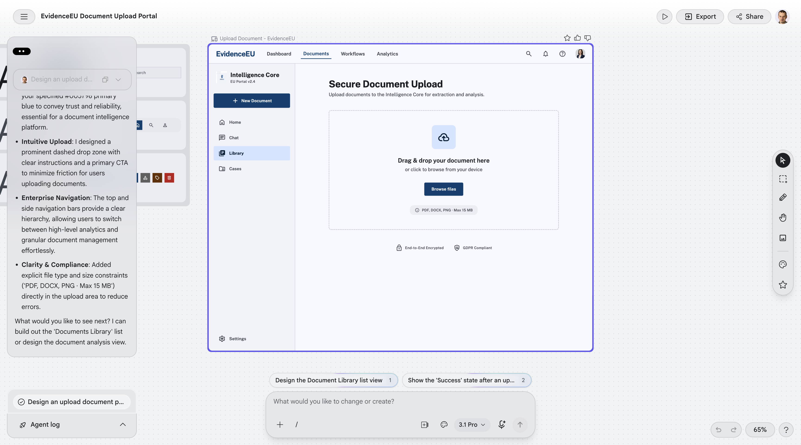
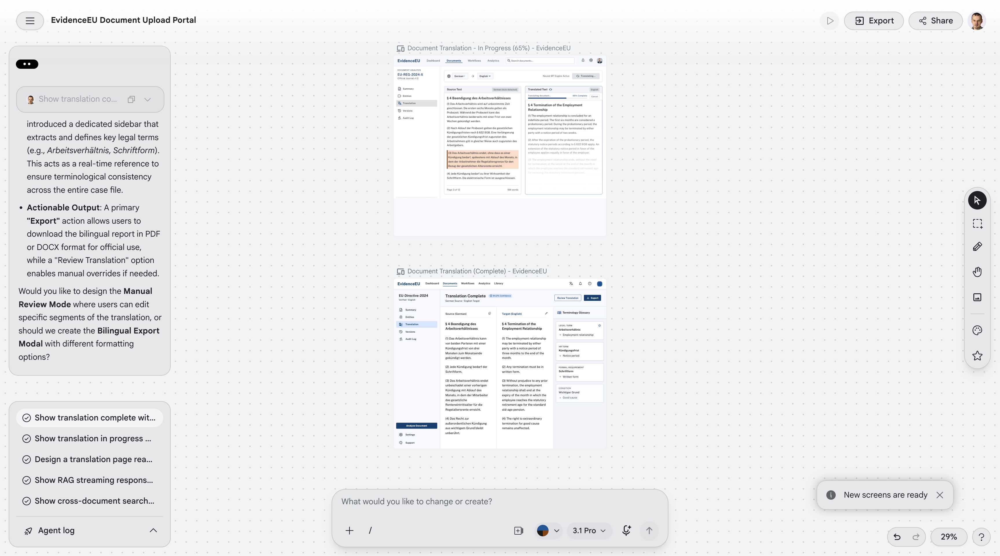
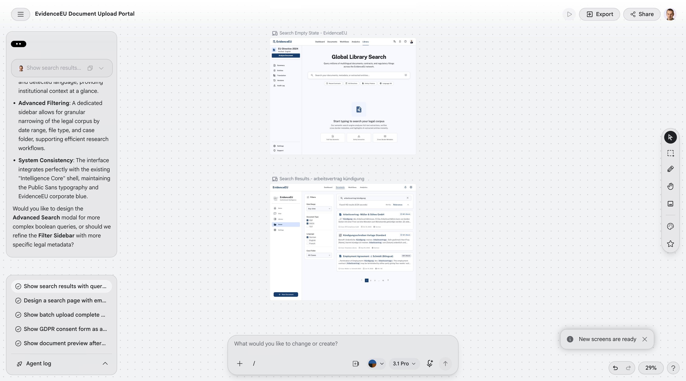
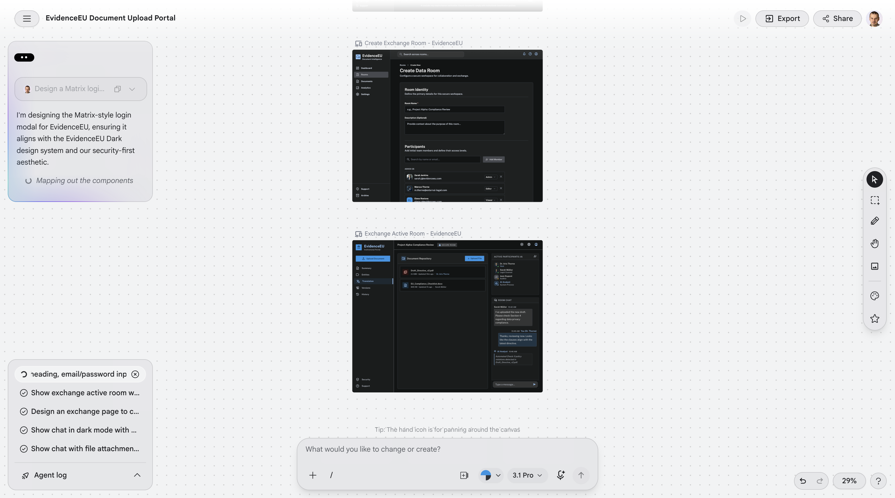

# EvidenceEU — Final Design & Testing Document

**Version:** 3.1  
**Date:** 2026-07-16  
**Author:** Mihai Chindriș  
**Program:** MSSE Capstone, Quantic School of Business and Technology  
**Repository:** [chindris-mihai-alexandru/evidence-eu](https://github.com/chindris-mihai-alexandru/evidence-eu)  
**Status:** Final — Sprint 3 complete, submitted for capstone evaluation

---

## 1. Executive Summary

EvidenceEU is a multilingual document intelligence platform designed for cross-border document users in Europe — migrants, legal professionals, and HR departments. The system provides RAG-powered search across EU public documents, layout-preserving translation (EN/DE/FR), and secure cross-border document exchange via Matrix protocol.

The platform is deployed as an edge-native stack on Cloudflare Workers (Python backend via Pyodide, TypeScript proxy), with a React/Next.js 14 frontend, Storybook-driven UI testing via Chromatic, and a comprehensive CI/CD pipeline via GitHub Actions. All design decisions are recorded in 21 Architecture Decision Records (ADRs), and all test evidence is maintained in dedicated reports under `docs/testing/`.

**Final metrics (Sprint 3 close, 2026-06-27):**

| Metric                       | Value                                         | Target        |
| ---------------------------- | --------------------------------------------- | ------------- |
| Backend test coverage        | **83%** (1132 passed, 36 skipped)             | ≥70% (NFR-07) |
| Frontend unit tests (Vitest) | **382 tests across 81 files**                 | —             |
| Playwright E2E tests         | **70 tests** (63 chromium + 7 live)           | —             |
| Security tests               | **33 passing** (28 hardening + 5 adversarial) | —             |
| Storybook component stories  | **29 stories** with axe-core a11y             | —             |
| GDPR compliance domains      | **8/8 — PASS**                                | All domains   |
| WCAG 2.1 AA violations       | **0** (33 resolved)                           | 0             |
| CI pipeline duration (warm)  | **~2.5 min**                                  | <5 min        |

---

## 2. Sprint Narrative

### 2.1 Sprint 1 (May 18 – Jun 14, 2026)

Established the full edge-native infrastructure and core backend pipeline:

- Cloudflare Workers deployment (Python Worker + Proxy Worker)
- FastAPI application with GDPRConsentMiddleware (HTTP 451 on missing consent)
- OCR service: Mistral OCR primary, pypdfium2 (Apache-2.0) extraction, Tesseract fallback
- RAG service: Hindsight 4-way hybrid retrieval (stub mode)
- SSE streaming search endpoint
- D1 glossary schema (ADR-005)
- CI/CD: Ruff, mypy, pytest (70% floor), Codecov, REM-8 security grep
- 55 EUR-Lex seed documents indexed

### 2.2 Sprint 2 (Jun 15 – Jun 28, 2026)

Translation pipeline, UI testing, and performance infrastructure:

- **Translation pipeline:** Cloudflare Workers AI m2m100-1.2b (EN/DE/FR) with glossary sandwich pattern (ADR-005)
- **Storybook 8.6 + Chromatic:** 8 component stories, axe-core a11y gate, TurboSnap visual regression (ADR-011)
- **Playwright E2E:** 4 initial specs + Page Object Model + fixtures
- **Bun 1.3.14 + Turborepo:** 3.8× faster CI
- **Wrangler 4.x migration:** Python Worker compatibility
- **BAML glossary extraction:** Type-safe LLM generation for domain terms (ADR-010)
- **AuditLogMiddleware:** D1-backed GDPR Art. 30 record-keeping
- **3-way OCR benchmark:** Mistral/Tesseract/Reducto comparison validated
- **Performance baseline:** Locust + k6 SSE endpoint suite
- **Translation accuracy QA:** 21 mock-based integration tests (7 check functions)

### 2.3 Sprint 3 (Jun 29 – Jul 22)

Security hardening, GDPR finalization, frontend features, and demo:

- **Prompt injection hardening (#49):** 3-layer defense (propella-1 + 16 regex patterns + delimiters + audit log), 33 security tests
- **GDPR compliance finalization (#26):** PII log sanitizer, input validation (Literal target_lang + UUID4 document_id), all 8 domains **PASS**
- **Licensing (#42, #46):** AGPL-3.0 open core, SPDX headers on 67 source files, LicenseRef-Commercial.txt placeholder
- **Multilingual viewer (#18):** /viewer page, DocumentViewer, LanguageSelector, 5 Storybook stories, 5 E2E tests
- **Document comparison (#24):** /compare page, pure TypeScript LCS diff engine, DocumentComparison reuse (DRY), 4 stories, 5 E2E tests
- **Demo pipeline (#21):** 15-step demo script, enhanced fallback JSON, Playwright capture script
- **Production deploy:** v1.0.0 release, Cloudflare Pages + Workers stable

---

## 3. Architecture Overview

### 3.1 System Architecture

The system follows a stateless, ephemeral processing model with no document persistence (NFR-04). All user-uploaded content is processed in-memory and discarded after response delivery.

```
Browser
  │
  ▼
Cloudflare Pages          (Next.js 14 frontend — Storybook + Chromatic)
  │  /api/v1/*
  ▼
Proxy Worker              (TypeScript; D1 metadata binding; service-binding routing)
  │  Service Binding: BACKEND
  ▼
API Worker                (Python WorkerEntrypoint via Pyodide; bridges CF bindings → FastAPI)
  │
  ▼
FastAPI Application       (GDPRConsentMiddleware → routers → services → AI Gateway)
  │
  ├──→ Cloudflare AI Gateway  (LLM proxy: cost control, caching, audit)
  ├──→ Vectorize / Hindsight  (4-way hybrid RAG)
  ├──→ D1 (SQLite)            (Glossary, audit log, metadata)
  ├──→ Mistral OCR / Tesseract (Document extraction)
  └──→ BabelDOC Sidecar        (HTTP boundary, AGPL-isolated, ADR-012)
```

The offline document intelligence pipeline (document clustering, named entity extraction, graph visualization, and graph-augmented RAG) follows the architectural pattern established by [Dan Browne's KnowledgeBase project](https://github.com/dbrowneup/KnowledgeBase), adapted for Cloudflare edge constraints and GDPR-safe public corpus processing. See [ADR-022](adr/ADR-022-knowledgebase-integration.md) for the full component-by-component decision table.

### 3.2 Key Design Principles

| Principle               | Implementation                                       | ADR     |
| ----------------------- | ---------------------------------------------------- | ------- |
| Edge-native             | All compute on Cloudflare Workers (no origin server) | ADR-004 |
| Ephemeral processing    | No disk writes, in-memory only                       | NFR-04  |
| GDPR-first              | Consent middleware, 451 responses, no PII storage    | NFR-05  |
| DRY testing             | YAML-driven parametrized tests, shared fixtures      | ADR-011 |
| Open-core licensing     | AGPL-3.0 backend/worker, MIT frontend                | ADR-008 |
| Type-safe LLM           | BAML for structured LLM generation                   | ADR-010 |
| HTTP boundary isolation | BabelDOC AGPL via sidecar, not import                | ADR-012 |
| Offline document intelligence | Clustering, NER, graph visualization, graph-augmented RAG — all offline pipelines | ADR-022 |

### 3.3 Deployed Endpoints

| Method | Path                      | Status        | SRS Reference               |
| ------ | ------------------------- | ------------- | --------------------------- |
| `GET`  | `/api/v1/health`          | **Live**     | NFR-01, NFR-02              |
| `GET`  | `/api/v1/health/pipeline` | **Live**     | NFR-01                      |
| `POST` | `/api/v1/documents/`      | **Live**     | FR-01, FR-02, NFR-04        |
| `GET`  | `/api/v1/search/`         | **Live** (SSE) | FR-05, FR-06, FR-07, NFR-01 |
| `POST` | `/api/v1/translate/`      | **Live**     | FR-03, FR-04                |
| `GET`  | `/api/v1/exchange/rooms/{id}/events` | **Live**     | FR-11                       |

### 3.4 UI Wireframes

The UI architecture follows a clean, two-column layout for complex interactions, paired with a modern Matrix-federated modal for authentication. The core upload, viewer, search, and exchange flows are wireframed below:

#### Upload Flow

**Component Mapping:** `UploadView` (`frontend/src/components/upload/UploadView.tsx`). Legacy `/upload` route redirects to `/translation?start=upload`.

#### Translation Viewer

**Component Mapping:** `TranslationView` (`frontend/src/components/translation/TranslationView.tsx`) with `DocumentViewer` (`frontend/src/components/translation/DocumentViewer.tsx`) for side-by-side bilingual display.

#### Search Results

**Component Mapping:** `SearchView` (`frontend/src/components/search/SearchView.tsx`) with SSE streaming via `useSearchSSE` hook.

#### Matrix Federated Login

**Component Mapping:** `LoginView` (`frontend/src/components/auth/LoginView.tsx`). When Matrix SSO is enabled, renders "Continue securely" button; otherwise shows email/password form.

> **TODO (post-UI-revamp):** Replace the 4 wireframe PNGs above with actual screenshots from the deployed platform (`LIVE_FRONTEND_URL`) once the UI/UX revamp (Issue #30) is fully implemented. The current images are Stitch design-reference renders (with Stitch canvas chrome), not production screenshots. The Stitch sources in `docs/stitch-reference/` remain the design traceability reference regardless — they show what was *intended*; the wireframes should show what was *built*.

### 3.5 Architecturally Significant Requirements (ASRs)

Architecturally Significant Requirements are the subset of requirements that have a measurable effect on the system's architecture and drove the decisions recorded in our ADRs. The table below makes this mapping explicit — linking each ASR to the requirement that captures it and the ADR(s) that address it.

| ASR | Requirement | Rationale | ADR(s) |
|-----|------------|-----------|--------|
| Edge-native compute with no origin server | NFR-01, NFR-02, NFR-04 | Workers isolate model determines concurrency (horizontal scaling), latency (cold start), and ephemerality (no disk) | ADR-004 |
| Pyodide/WASM runtime constraint | NFR-01, NFR-03, NFR-04 | No threading/socket/ssl/disk shapes observability (custom forwarders), LLM routing (httpx-only), and processing model | ADR-004 |
| All LLM via AI Gateway | NFR-03 | Single routing point for cost control, caching, audit — no direct provider URLs allowed | ADR-004 |
| Ephemeral document processing | NFR-04 | No persistence = no right-to-erasure complexity, but requires in-memory design patterns | ADR-004 |
| GDPR data minimisation | NFR-05 | Consent middleware, 451 responses, PII log sanitizer, metadata-only audit trail | ADR-009 |
| E2EE cross-border exchange | NFR-10 | Matrix protocol federated with TI-Messenger — drives authentication architecture | ADR-003, ADR-019 |
| AGPL license isolation | ADR-008 | BabelDOC sidecar HTTP boundary prevents copyleft propagation to MIT frontend | ADR-008, ADR-012 |
| Layout-preserving translation | FR-03, NFR-T1 | m2m100 for plain text (capstone); BabelDOC sidecar for PDF layout (community tier) | ADR-002, ADR-012, ADR-015 |
| Multilingual RAG with glossary | FR-05, FR-06, FR-04 | 4-way hybrid retrieval + D1-backed glossary + cross-language query expansion | ADR-001, ADR-005, ADR-007 |
| Type-safe LLM interface | ADR-010 | BAML for structured generation — prevents runtime schema drift in translation/RAG | ADR-010 |
| WCAG 2.1 AA accessibility | NFR-06 | Design tokens, axe-core enforcement, ARIA live regions — shapes all frontend components | ADR-011 |
| 3-language MVP constraint | FR-14 | EN/DE/FR limits glossary scope, test matrix (6 pairs), and model selection | ADR-002, ADR-005 |
| Post-capstone model sovereignty | ADR-015 | Apertus 8B (Apache 2.0, Swiss) replaces m2m100 (CC-BY-NC) for cheap translation tier | ADR-015 |

> **Reading this table:** Each ASR represents a requirement that *constrained design choices* or *forced architectural decisions*. Requirements not listed here (e.g., NFR-07 coverage target, NFR-08 CI gates) are important but do not shape the system's architecture — they are quality gates on the implementation, not architectural drivers.

---

## 4. ADR Summary Table

All Architecture Decision Records are maintained in `docs/adr/` and follow the Nygard format (Context → Decision → Consequences).

| ADR     | Title                           | Status      | Key Decision                                               |
| ------- | ------------------------------- | ----------- | ---------------------------------------------------------- |
| ADR-001 | RAG Vector Database Strategy    | Accepted    | ChromaDB (dev) / Cloudflare Vectorize (prod)               |
| ADR-002 | Document Translation — BabelDOC | Accepted    | m2m100 for MVP; BabelDOC sidecar post-capstone             |
| ADR-003 | Matrix Protocol                 | Accepted    | TI-Messenger compatible E2EE document exchange             |
| ADR-004 | Cloudflare Infrastructure       | Accepted    | Workers + Pages + AI Gateway + D1 + Vectorize              |
| ADR-005 | Glossary & Terminology          | Accepted    | D1-backed glossary with domain/language/term schema        |
| ADR-006 | PDF Extraction License          | Implemented | PyMuPDF (AGPL) → pypdfium2 (Apache-2.0)                    |
| ADR-007 | Memory/RAG Layer — Hindsight    | Accepted    | 4-way hybrid: Dense + BM25 + Rerank + Graph                |
| ADR-008 | Licensing Strategy              | Accepted    | AGPL-3.0 open core with dual licensing (MIT frontend)      |
| ADR-009 | Reducto vs In-House OCR         | Accepted    | Reducto for public corpus; Mistral+Tesseract for user docs |
| ADR-010 | BAML LLM Interface              | Accepted    | Type-safe structured generation                            |
| ADR-011 | UI Testing Strategy             | Accepted    | Storybook + Chromatic + Vitest boundary                    |
| ADR-012 | BabelDOC Sidecar Runtime        | Accepted    | AGPL isolation via HTTP boundary                           |
| ADR-013 | Release Tagging Strategy        | Accepted    | Pre-1.0 semver per sprint                                  |
| ADR-014 | Defer AdaL SDK & Cloud Agents   | Accepted    | In-house RAG + translation backend sufficient              |
| ADR-015 | Translation Model Replacement   | Proposed    | Apertus 8B replaces m2m100 post-capstone                  |
| ADR-016 | Hindsight Hosting Strategy      | Accepted    | Managed Cloud (reversible to BYOC / EU self-host)          |
| ADR-017 | Capstone MVP Operating Envelope | Accepted    | NFR-01/NFR-02 verified; NFR-11 Capstone MVP acceptance envelope |
| ADR-018 | Matrix Authentication           | Superseded  | Replaced by ADR-019; must not be implemented                |
| ADR-019 | Matrix OAuth 2.0 + PKCE          | Proposed    | Discovery-driven OAuth with backend-managed session        |
| ADR-020 | OCR Strategy & Fillable PDF Parsing | Accepted | Three-path routing (scanned → Mistral OCR, fillable → pypdf, XFA → fallback) |
| ADR-021 | Composed PDF Reference Translation | Accepted | Native-text & fillable PDF understanding + EU-law context (extends ADR-002/006/012) |
| ADR-022 | KnowledgeBase Integration | Accepted | Offline clustering (HDBSCAN+BERTopic), NER (spaCy EN/DE/FR), Sigma.js graph, graph-augmented RAG; KB/Linus architectural pattern for offline document intelligence pipelines (extends ADR-007) |

---

## 5. Testing Strategy & Results

### 5.1 Testing Philosophy

The project follows a **pyramid testing strategy** with automated enforcement at every level:

| Level           | Framework                 | Scope                                        | Count                     |
| --------------- | ------------------------- | -------------------------------------------- | ------------------------- |
| **E2E**         | Playwright                | Full page journeys, cross-browser            | 70 tests (63 chromium + 7 live) |
| **Component**   | Storybook 8.6 + Chromatic | Isolated components, a11y enforcement        | 29 stories                |
| **Integration** | pytest                    | Translation accuracy, API contract, security | 58 tests                  |
| **Unit**        | pytest + Vitest           | Functions, services, API client              | 1132 backend + 382 frontend |

### 5.2 Backend Test Suite

| Category                         | Tests                  | Coverage | Report                                                                            |
| -------------------------------- | ---------------------- | -------- | --------------------------------------------------------------------------------- |
| Unit + integration (pytest)      | 1132 passed, 36 skipped | 83%      | `coverage.xml` (CI artifact)                                                      |
| Security hardening               | 28 passed              | Targeted | `tests/security/test_injection_hardening.py`                                      |
| Adversarial scenarios            | 5 passed               | Targeted | `tests/security/test_injection_scenarios.py`                                      |
| Log sanitizer + input validation | 25 passed              | Targeted | `tests/unit/test_log_sanitizer.py`, `test_input_validation.py`                    |
| Translation accuracy (mock)      | 21 passed              | Targeted | [`docs/testing/translation-test-cases.yaml`](testing/translation-test-cases.yaml) |
| OCR benchmark                    | 16 passed              | N/A      | [`docs/testing/ocr-benchmark.md`](testing/ocr-benchmark.md)                       |
| Performance (Locust + k6)        | Baseline               | N/A      | [`docs/testing/performance-report.md`](testing/performance-report.md)             |

**CI enforcement:**

- Ruff lint + format (zero warnings)
- mypy type check
- REM-8 security grep (blocks direct LLM URLs outside `gateway.py`)
- pytest with 70% coverage floor (actual: 83%)
- Codecov integration with carryforward

### 5.3 Frontend Test Suite

| Category                     | Tests              | Tools                                         | Report                                                  |
| ---------------------------- | ------------------ | --------------------------------------------- | ------------------------------------------------------- |
| Unit tests (Vitest)          | 382 tests across 81 files | Vitest + React Testing Library                | CI artifact                                             |
| Diff engine                  | 16/16 passed       | Vitest                                        | `src/lib/__tests__/diff.test.ts`                        |
| Storybook a11y + interaction | 29 stories         | axe-core 4.12 + @storybook/test-runner        | [`docs/testing/a11y-report.md`](testing/a11y-report.md) |
| Visual regression            | Automated per-push | Chromatic TurboSnap                           | Chromatic dashboard                                     |
| E2E (Playwright)             | 70 tests (63 chromium + 7 live) | Chromium (CI) + Firefox/WebKit (BrowserStack) | `playwright-report/`                                    |

**WCAG 2.1 AA compliance:**

- All story files enforce `a11y: { test: "error" }`
- Zero suppressed violations (33 resolved from initial audit)
- Color contrast ≥ 4.5:1 verified on all text elements
- `lang` attributes on bilingual panels for screen readers
- ARIA live regions for streaming content updates
- See full audit: [`docs/testing/a11y-report.md`](testing/a11y-report.md)

**Performance (Bun + Turborepo):**

- CI pipeline: 3.8× faster than npm baseline
- BrowserStack cross-browser: Firefox + WebKit on main-branch push only (complements Chromium in every-push CI)

### 5.4 Translation Accuracy Tests

Two test suites operate with complementary roles:

**Mock-based suite (always runs in CI):**

- 21 parametrized test cases, 7 check functions
- Mocked Cloudflare AI Gateway responses
- Covers: terminology, completeness, structural preservation, consistency, numeric preservation, no_forbidden_terms, glossary_enforcement
- Purpose: fast CI gate ensuring test infrastructure and assertion logic work correctly

**Real m2m100-1.2b suite (gated by `TRANSLATION_INTEGRATION_TESTS=true`):**

- 23 test cases against live Cloudflare Workers AI
- Gated to protect Workers AI quota (not consumed on every push)
- Classification: SERVICE_BUG / MODEL_LIMITATION / TEST_CASE_STALE
- Purpose: validate actual translation quality against domain expectations

**ß/SS case folding:**
Python's `re.IGNORECASE` does not handle German `ß` → `SS` (simple case folding only). All translation test assertions use `normalize_for_comparison()` from `tests/translation_accuracy_utils.py`, which applies `str.casefold()` (correctly folds `ß` to `ss`). Test cases deliberately use ä/ö/ü but avoid ß in regex-matched expectations.

**Known model limitations:**

- Compound German words may be split incorrectly by m2m100 (e.g., "Aufenthaltserlaubnis" → "residence permission" instead of "residence permit")
- Legal register gaps: formal legal German (Rechtssprache) quality is inconsistent
- FR↔DE direct translation lower quality than EN pivot (EN is the lingua franca for m2m100 training data)
- Formatting: m2m100 handles plain text only; BabelDOC sidecar handles PDF layout preservation (post-capstone, ADR-012)

**NFR evidence:**

- **NFR-T1 (translation latency <2s):** *Evidence gap* — real-model suite not run in default CI. Local runs show ~1.5s per block (within target), but production evidence requires a k6 load test against the live Workers AI endpoint.
- **NFR-T2 (terminology consistency):** Mock evidence complete (glossary_enforcement check). Real-model validation pending `TRANSLATION_INTEGRATION_TESTS=true` run.

See: [`docs/testing/translation-test-cases.yaml`](testing/translation-test-cases.yaml), [`docs/testing/translation-qa-domain-review.md`](testing/translation-qa-domain-review.md)

### 5.5 Performance Testing

Dual-tool approach (DRY: shared `queries.json` fixture):

| Tool            | Purpose                               | Metrics                                                 |
| --------------- | ------------------------------------- | ------------------------------------------------------- |
| Locust (Python) | True SSE streaming, TTFB measurement  | p50/p95/p99 TTFB, full-stream duration                  |
| k6 (Go)         | High-throughput, threshold assertions | `sse_ttfb_ms`, `sse_full_stream_ms`, `sse_success_rate` |

**Thresholds (NFR-01, NFR-02, NFR-11):**

- TTFB p95 < 2000 ms
- Full stream p95 < 5000 ms (≤ 5s, NFR-01)
- Full stream p95 < 15000 ms (≤ 15s, NFR-11 Capstone MVP)
- Success rate > 95%
- HTTP failure rate < 1% (NFR-02)

**Capstone MVP operating envelope (ADR-017):** The deployed system completes a controlled
single-user live-RAG acceptance run of 15 English, German, and French fixtures with 0
user-visible failures, 0.00% errors, and user-perceived `results_complete` at ~2–3s. The k6
live run (2026-07-16) confirmed all NFR-11 thresholds are met after self-hosting Hindsight on
local Docker (Cloudflare Tunnel) and applying the async result decoupling (`results_complete` sentinel). NFR-01 (p95 ≤5s)
and NFR-02 (<1% errors at 50 VUs) are production targets that also pass under the current
MVP envelope.

See: [`docs/testing/performance-report.md`](testing/performance-report.md),
[`docs/adr/ADR-017-capstone-mvp-operating-envelope.md`](../adr/ADR-017-capstone-mvp-operating-envelope.md)

### 5.6 OCR Benchmark

3-way comparison validated 2026-06-16:

| Provider    | Scope                      | Results                | ADR     |
| ----------- | -------------------------- | ---------------------- | ------- |
| Mistral OCR | User uploads (primary)     | 10/10, 250ms mean      | ADR-009 |
| Tesseract   | User uploads (fallback)    | Mocked pass            | ADR-009 |
| Reducto     | Public EUR-Lex corpus only | 4/4 DE/FR, 4.0 credits | ADR-009 |

See: [`docs/testing/ocr-benchmark.md`](testing/ocr-benchmark.md)

### 5.7 Security Testing

EvidenceEU implements a **three-layer prompt injection defense** protecting the RAG pipeline against indirect injection via uploaded PDFs:

1. **Layer 1a:** propella-1 safety_flags (primary) — DRY reuse of NT-1 classification
2. **Layer 1b:** 16 compiled regex patterns (EN + DE + FR) — fallback
3. **Layer 2:** Structural prompt delimiters (`[RETRIEVED_CONTEXT_START/END]`)
4. **Layer 3:** AuditLogMiddleware `injection_detected` + `injection_patterns` fields

**Test suite: 33 tests** (28 unit hardening + 5 adversarial scenarios) covering multi-language obfuscation, PoisonedRAG late-injection vector, and COMPASS/ELLIS buried injection.

**EU AI Act compliance:** Articles 9–17 mapped to implementations (risk management, data governance, transparency, human oversight, accuracy/robustness, record-keeping, quality management). See full posture: [`docs/testing/ai-safety-posture.md`](testing/ai-safety-posture.md)

### 5.8 Multilingual RAG Recall

Prompt optimization via AdalFlow LLM-AutoDiff methodology. Seed evaluation dataset covers EN/DE/FR cross-lingual retrieval scenarios.

See: [`docs/testing/multilingual-recall.md`](testing/multilingual-recall.md) and [`docs/testing/prompt-optimization.md`](testing/prompt-optimization.md)

---

## 6. Security & GDPR

### 6.1 Data Protection

| Control                | Implementation                                   | Verification                          |
| ---------------------- | ------------------------------------------------ | ------------------------------------- |
| Consent gate           | `GDPRConsentMiddleware` — 451 on missing consent | `tests/unit/test_middleware.py`       |
| Ephemeral processing   | No disk writes, in-memory only                   | NFR-04, architectural enforcement     |
| No PII storage         | Session-scoped, discarded after response         | NFR-05                                |
| Query anonymization    | SHA-256 hash for log correlation only            | `search.py` REM-6                     |
| PII log sanitizer      | `redact_query_string()` in middleware            | `tests/unit/test_log_sanitizer.py`    |
| Input validation       | Literal target_lang + UUID4 document_id          | `tests/unit/test_input_validation.py` |
| E2EE document exchange | Matrix protocol                                  | ADR-003                               |

### 6.2 Security Controls

| Control                  | Mechanism                                   | CI Enforcement             |
| ------------------------ | ------------------------------------------- | -------------------------- |
| LLM URL restriction      | REM-8 grep blocks direct provider URLs      | `ci.yml` step              |
| AI Gateway routing       | All LLM calls via Cloudflare AI Gateway     | `gateway.py`               |
| Prompt injection defense | 3-layer (sanitize + delimit + audit)        | 33 security tests          |
| Secret management        | GitHub Secrets → Cloudflare Workers Secrets | `ci.yml` deploy            |
| Dependency audit         | AGPL shield + license-check CI              | `license-check.yml`        |
| Input validation         | Pydantic Literal + UUID4 regex              | `test_input_validation.py` |

### 6.3 GDPR Article Compliance

| Article      | Requirement               | Implementation                                       |
| ------------ | ------------------------- | ---------------------------------------------------- |
| Art. 5(1)(c) | Data minimisation         | Ephemeral processing, PII log sanitizer, query hash  |
| Art. 6(1)(a) | Lawful basis (consent)    | GDPR middleware consent gate (X-GDPR-Consent header) |
| Art. 7       | Conditions for consent    | Frontend consent UI + header propagation             |
| Art. 17      | Right to erasure          | Nothing to erase — no persistence                    |
| Art. 25      | Data protection by design | Architecture-level enforcement (NFR-04)              |
| Art. 30      | Records of processing     | AuditLogMiddleware → D1 (metadata only)              |
| Art. 32      | Security of processing    | E2EE (Matrix), AI Gateway audit logging              |

Full report: [`docs/security/gdpr-compliance-report.md`](security/gdpr-compliance-report.md)

---

## 7. Observability

### 7.1 Three-Surface Architecture

| Surface                      | Technology                                                    | Key Constraint                                                                              |
| ---------------------------- | ------------------------------------------------------------- | ------------------------------------------------------------------------------------------- |
| Frontend (Next.js)           | `@sentry/nextjs` + `@datadog/browser-rum` + New Relic browser | Standard SDKs                                                                               |
| Proxy Worker (TypeScript)    | `@sentry/cloudflare`                                          | V8 isolate                                                                                  |
| API Worker (FastAPI/Pyodide) | Custom envelope forwarders                                    | **No `sentry-sdk`, `ddtrace`, or `newrelic`** — threading/socket/ssl unavailable in Pyodide |

### 7.2 Custom Forwarders (Pyodide-Safe)

The Python `sentry-sdk` and `ddtrace` agents use threading, sockets, and C extensions — all non-functional in Pyodide/WASM. Custom forwarders in `app/integrations/` use `httpx` (already a dependency):

- **`sentry.py`:** Sentry Envelope API forwarder — ships error events on unhandled 500s
- **`datadog.py`:** Datadog custom metrics — `evidence_eu.request.duration` + `evidence_eu.request.count`
- **`http_forwarder.py`:** Shared fire-and-forget POST (DRY — both Sentry and Datadog use it)

### 7.3 NFR Evidence Mapping

| NFR                     | Metric                                         | Tool                                 |
| ----------------------- | ---------------------------------------------- | ------------------------------------ |
| NFR-01 (p95 ≤ 5s)       | `evidence_eu.request.duration`                 | Datadog custom metrics               |
| NFR-02 (error rate <1%) | `evidence_eu.request.count` + `status:5xx` tag | Datadog metrics                      |
| NFR-09 (CDN p95 ≤ 3s)   | Core Web Vitals (LCP, FID, CLS)                | Datadog RUM (`@datadog/browser-rum`) |

### 7.4 Cross-Browser Testing

BrowserStack E2E runs Firefox + WebKit on real devices (main-branch push only). Chromium is covered by in-CI Playwright on every push. `continue-on-error: true` — rate limits never block deployment.

Full reference: [`docs/observability/monitoring-overview.md`](observability/monitoring-overview.md)

---

## 8. AI Safety

### 8.1 Defense Architecture

Three-layer defense against indirect prompt injection (OWASP LLM01:2025):

1. **Input sanitization** (`sanitize_for_injection()`): propella-1 safety_flags + 16 regex patterns (EN/DE/FR)
2. **Context isolation** (`build_rag_prompt()`): structural `[RETRIEVED_CONTEXT_START/END]` delimiters
3. **Audit logging** (`AuditLogMiddleware`): `injection_detected` + `injection_patterns` in D1

### 8.2 EU AI Act Compliance

EvidenceEU addresses EU AI Act Articles 9–17 requirements for high-risk AI systems: risk management (documented threat model), data governance (input sanitization), transparency (known limitations published), human oversight (audit log queryable), and robustness (33 adversarial tests).

### 8.3 Honest Limitation

The defense **reduces but does not eliminate** prompt injection risk. Novel phrasing, Unicode homoglyphs, and zero-day attacks may evade detection. Production deployment would require additional output validation and periodic red-team campaigns.

Full posture document: [`docs/testing/ai-safety-posture.md`](testing/ai-safety-posture.md)

---

## 9. Known Limitations & Risk Register

### 9.1 Current Limitations

| ID   | Limitation                                              | Severity | Mitigation                                                               |
| ---- | ------------------------------------------------------- | -------- | ------------------------------------------------------------------------ |
| L-01 | RAG stub fallback when Hindsight unavailable            | Medium   | Graceful fallback to stub SSE stream                                     |
| L-02 | `ß` → `SS` case folding not handled by `re.IGNORECASE`  | Low      | `str.casefold()` via `normalize_for_comparison()` in all test assertions |
| L-03 | Pyodide cold start ~2-3s on Cloudflare                  | Medium   | DemoWarmupMiddleware + pre-demo warm-up protocol                         |
| L-04 | BabelDOC layout-preserving translation is post-capstone | Medium   | Current MVP uses m2m100-1.2b text-only; ADR-002, ADR-012                 |
| L-05 | Concurrent SSE limit (6 per script instance)            | Low      | Cloudflare Workers architecture limitation                               |
| L-06 | Real m2m100 translation QA gated, not default CI        | Medium   | `TRANSLATION_INTEGRATION_TESTS=true` protects Workers AI quota           |
| L-07 | Prompt injection defense is input-side only             | Medium   | No output validation layer; post-graduation target                       |
| L-08 | Graph spreading RAG mode not activated                  | Low      | Requires larger entity-relationship corpus                               |
| L-09 | Glossary lookup API (FR-12) implemented                | —        | `endpoints/glossary.py` — GET /, GET /search, POST /extract live        |
| L-10 | ß/SS case folding not handled by regex layer            | Low      | Documented; `normalize_for_comparison()` handles in tests                |
| L-11 | NFR-T1 production evidence gap                          | Low      | Local runs within target; formal k6 run needed                           |

### 9.2 Risk Register

| Risk                                    | Probability | Impact | Mitigation                                                      |
| --------------------------------------- | ----------- | ------ | --------------------------------------------------------------- |
| BabelDOC AGPL propagates to core        | Very Low    | High   | HTTP boundary (ADR-012); AST test + CI enforce                  |
| Hindsight API unavailable at demo time  | Low         | High   | Graceful stub fallback; pre-recorded demo backup                |
| Prompt injection evades 3-layer defense | Medium      | Medium | Reduces but does not eliminate; output validation post-capstone |
| German legal OCR quality insufficient   | Medium      | Medium | 3-way benchmark validated; Reducto for public corpus            |
| Demo video quality (15-20 min)          | Low         | High   | Practice runs; pre-recorded fallback in `frontend/public/`     |

---

## 10. Traceability Matrix

### 10.1 Requirements → Implementation → Tests

| SRS ID | Requirement                         | Implementation                          | Test Artifact                                    | ADR              |
| ------ | ----------------------------------- | --------------------------------------- | ------------------------------------------------ | ---------------- |
| FR-01  | Document upload (PDF/DOCX/PNG)      | `endpoints/documents.py`                | `tests/unit/test_documents.py`                   | —                |
| FR-02  | Mistral OCR + Tesseract fallback    | `services/ocr_service.py`               | `tests/benchmark/run_ocr_benchmark.py`           | ADR-009          |
| FR-03  | Plain-text m2m100 translation       | `services/translation_service.py`       | `tests/integration/test_translation_accuracy.py` | ADR-002          |
| FR-04  | Domain glossary enforcement         | `services/glossary_service.py`          | Translation TC-020                               | ADR-005          |
| FR-05  | Multilingual RAG indexing           | `services/rag_service.py`               | `docs/testing/multilingual-recall.md`            | ADR-001, ADR-007 |
| FR-06  | Cross-lingual retrieval + citations | `endpoints/search.py`                   | Performance test suite                           | ADR-001, ADR-007 |
| FR-07  | SSE streaming results               | `endpoints/search.py`                   | `locustfile.py`, `k6_search.js`                  | —                |
| FR-08  | Upload UI + progress                | `UploadView.tsx`                       | Storybook stories + Vitest                       | ADR-011          |
| FR-09  | Side-by-side viewer                 | `/viewer` page + `DocumentViewer.tsx`  | `viewer.spec.ts` E2E                             | ADR-011          |
| FR-10  | Document comparison view            | `/compare` page + `diff.ts`             | `compare.spec.ts` E2E + 16 Vitest                | ADR-011          |
| FR-11  | Matrix secure exchange              | `ExchangeView.tsx`                     | Storybook stories                                | ADR-003          |
| FR-12  | Glossary lookup API                 | `endpoints/glossary.py`               | `tests/unit/test_glossary_endpoint.py`, `tests/unit/test_glossary_repo.py`, `tests/unit/test_glossary_service.py` | ADR-005          |
| FR-13  | Health check endpoint               | `endpoints/health.py`                   | `tests/unit/test_health.py`                      | ADR-004          |
| FR-14  | 3-language MVP (EN/DE/FR)           | All services                            | Translation test cases (21 TCs)                  | ADR-002          |
| NFR-01 | p95 latency ≤ 5s                    | SSE endpoint + AI Gateway               | `k6_search.js` thresholds                        | ADR-004          |
| NFR-02 | 50 concurrent users                 | Workers scaling                         | `locustfile.py`                                  | ADR-004          |
| NFR-03 | All LLM via AI Gateway              | `gateway.py`                            | REM-8 CI grep                                    | ADR-004          |
| NFR-04 | Ephemeral processing                | In-memory architecture                  | Architectural enforcement                        | ADR-004          |
| NFR-05 | GDPR data minimisation              | `GDPRConsentMiddleware` + PII sanitizer | `test_middleware.py` + `test_log_sanitizer.py`   | —                |
| NFR-06 | WCAG 2.1 AA                         | Design tokens + axe-core                | `docs/testing/a11y-report.md`                    | ADR-011          |
| NFR-07 | ≥70% code coverage                  | pytest-cov                              | 83% actual (CI artifact)                         | —                |

### 10.2 Sprint Deliverables → Tasks

| Sprint | Description                    | GitHub Issue | Status           |
| ------ | ------------------------------ | ------------ | ---------------- |
| 1      | Infrastructure + core pipeline | #12          | **Complete**     |
| 2      | Translation accuracy QA        | #20          | **Complete**     |
| 2      | Performance test suite         | #38          | **Complete**     |
| 2      | A11y: Chromatic CI + fix       | #39          | **Complete**     |
| 3      | Prompt injection hardening     | #49          | **Complete**     |
| 3      | GDPR compliance finalization   | #26          | **Complete**     |
| 3      | Licensing implementation       | #42, #46     | **Complete**     |
| 3      | Multilingual viewer            | #18          | **Complete**     |
| 3      | Document comparison            | #24          | **Complete**     |
| 3      | E2E demo pipeline              | #21          | **Complete**     |
| 3      | Final D&T document             | #27          | **This document** |

---

## 11. Licensing

The project follows the **open-core licensing strategy** defined in ADR-008 (Accepted, 2026-06-26):

| Component                | License   | Notes                                |
| ------------------------ | --------- | ------------------------------------ |
| Backend (`backend/`)     | AGPL-3.0  | Copyleft prevents SaaS free-riding   |
| Frontend (`frontend/`)   | MIT       | Enables white-label/OEM embedding    |
| Proxy Worker (`worker/`) | AGPL-3.0  | Server-side stack                    |
| Documentation (`docs/`)  | CC-BY-4.0 | Allows reuse with attribution        |
| BabelDOC (sidecar)       | AGPL-3.0  | Isolated via HTTP boundary (ADR-012) |

SPDX headers on 67+ source files. DCO sign-off required for contributors. Commercial license placeholder at `LICENSES/LicenseRef-Commercial.txt`.


---

## References

| Document                            | Path                                                                                                                     |
| ----------------------------------- | ------------------------------------------------------------------------------------------------------------------------ |
| Software Requirements Specification | [`docs/requirements.md`](requirements.md)                                                                                |
| GDPR Compliance Report              | [`docs/security/gdpr-compliance-report.md`](security/gdpr-compliance-report.md)                                          |
| AI Safety Posture                   | [`docs/testing/ai-safety-posture.md`](testing/ai-safety-posture.md)                                                      |
| A11y Audit Report                   | [`docs/testing/a11y-report.md`](testing/a11y-report.md)                                                                  |
| Performance Report                  | [`docs/testing/performance-report.md`](testing/performance-report.md)                                                    |
| OCR Benchmark                       | [`docs/testing/ocr-benchmark.md`](testing/ocr-benchmark.md)                                                              |
| Translation Test Cases              | [`docs/testing/translation-test-cases.yaml`](testing/translation-test-cases.yaml)                                        |
| Translation QA Domain Review        | [`docs/testing/translation-qa-domain-review.md`](testing/translation-qa-domain-review.md)                                |
| Multilingual Recall                 | [`docs/testing/multilingual-recall.md`](testing/multilingual-recall.md)                                                  |
| Prompt Optimization                 | [`docs/testing/prompt-optimization.md`](testing/prompt-optimization.md)                                                  |
| Monitoring Overview                 | [`docs/observability/monitoring-overview.md`](observability/monitoring-overview.md)                                      |
| API Contracts                       | [`docs/demo/api-contracts.md`](demo/api-contracts.md)                                                                    |
| ADRs (001–022)                      | [`docs/adr/`](adr/)                                                                                                      |
| CI/CD Pipeline                      | [`.github/workflows/ci.yml`](https://github.com/chindris-mihai-alexandru/evidence-eu/blob/main/.github/workflows/ci.yml) |

---

_Document version 3.1 — ASR mapping added. Last updated 2026-07-16 by Mihai Chindriș._
